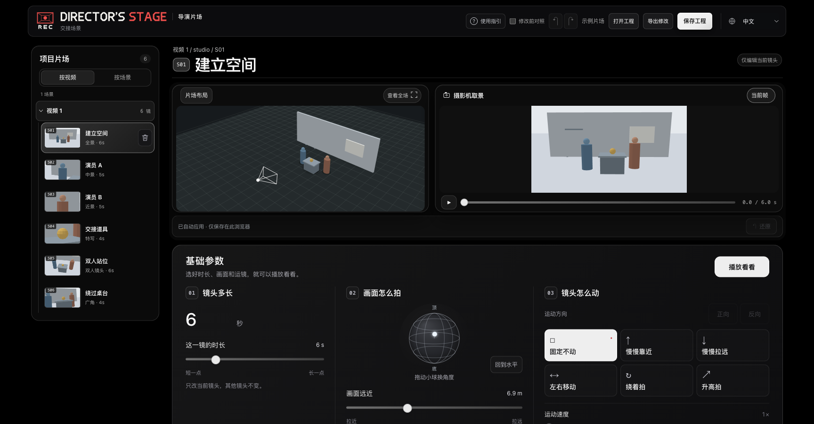

# Director’s Stage · 导演片场 UI

可独立运行、可自行部署的 3D 片场与摄影机编辑器前端。用于集成到 Creative Space 或其他已有产品，包含界面、浏览器渲染器和通用示例工程。



## 启动

需要 Node.js 22 或更新版本，无运行时依赖。

```sh
npm start
```

打开 `http://127.0.0.1:4173/`。默认载入一场六镜的通用示例，可直接调整摄影机、主体、镜头时长和运动路径。

```sh
npm test
npm run build
```

构建输出为 `dist/`，可放到自己的静态资源服务中。页面使用相对资源路径，支持部署在子目录。请通过 HTTPS 或本机 localhost 服务运行（需要浏览器安全上下文），不以双击 HTML 文件作为受支持的启动方式。

## 包含的界面能力

- 黑色底色、红色 REC 标志，中／英／日／韩界面。
- 视频与场景分组、镜头缩略图、删除与撤销。
- 自由 3D 观察、俯视布局、实时摄影机取景。
- 基础／高级参数、摄影机球形控制、焦距和构图辅助线。
- 运镜预设、正反向、速度、路径途经点和停留。
- 主体走位、几何体添加、简单状态事件。
- 本地草稿、修改前对照、撤销／重做、帧快照和标记数据。
- JSON 工程导入导出，以及可替换的宿主加载／保存接口。

## 集成范围

本仓库提供 UI 和浏览器内的编辑逻辑，不包含视频生成 Skill、Agent 系统提示词、Python 视频渲染工具、Flova OAuth 服务端或任何个人项目资料。

默认模式可以本地编辑并下载工程 JSON。接入产品时，由宿主负责用户登录、项目权限、工程存储、媒体地址和提交操作。保存接口未配置时，页面不会伪装成已经写入远程项目。

接口和数据格式见 [集成说明](docs/INTEGRATION.md)。

## 目录

```text
web/        前端源文件与通用 demo.json
scripts/    本地静态服务器和构建脚本
tests/      发布包与前端接入检查
docs/       工程结构及宿主接口说明
examples/   可直接导入的最小工程
```

界面保存的工程与标记可作为宿主工作流的输入；如何生成视频、如何解释这些数据，由集成方自己的业务逻辑处理。
